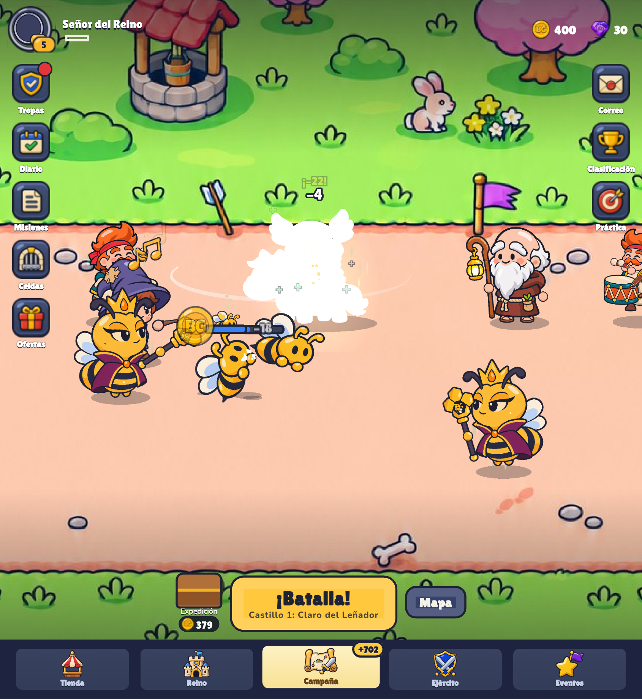

# Bug 2026-11-12T20:42:32.152Z

Es para guardar el token



```json
{
 "pantalla": "menu",
 "fecha": "2026-11-12T20:42:32.152Z",
 "ancho": 845,
 "alto": 919,
 "dpr": 2.549999952316284,
 "ua": "Mozilla/5.0 (Linux; Android 10; K) AppleWebKit/537.36 (KHTML, like Gecko) Chrome/156.0.0.0 Safari/537.36",
 "batalla": false,
 "tiempo": 11,
 "run": null,
 "mano": [
  "ninja",
  "odo",
  "lobo",
  "kubi"
 ],
 "unidades": [
  "valkiria:p:attack:88",
  "odo:b:idle:90",
  "ivo:b:idle:3",
  "fraile:p:idle:60",
  "rhea:b:attack:110",
  "rhea:p:walk:110",
  "abeja:b:die:0",
  "abeja:b:idle:4",
  "odo:p:spawn:90",
  "abeja:b:walk:22"
 ]
}
```
