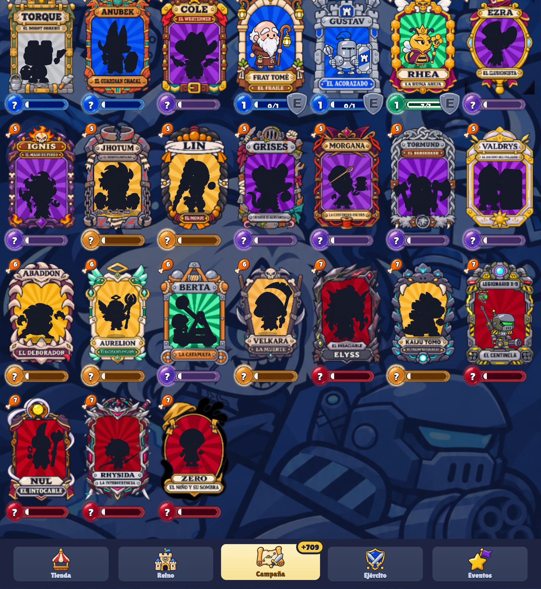

# Bug 2026-11-12T20:44:55.944Z

El marco de Nul está bien animado, pero detrás se ve otro marco estático.



```json
{
 "pantalla": "ejercito",
 "fecha": "2026-11-12T20:44:55.944Z",
 "ancho": 845,
 "alto": 919,
 "dpr": 2.549999952316284,
 "ua": "Mozilla/5.0 (Linux; Android 10; K) AppleWebKit/537.36 (KHTML, like Gecko) Chrome/156.0.0.0 Safari/537.36",
 "batalla": false,
 "tiempo": 95,
 "run": null,
 "mano": [
  "valkiria",
  "ivo",
  "kubi",
  "rhea"
 ],
 "unidades": [
  "odo:p:idle:90",
  "valkiria:p:attack:42",
  "fraile:p:idle:60",
  "rhea:p:idle:110",
  "fraile:b:attack:30",
  "abeja:p:die:0",
  "fraile:b:idle:60",
  "abeja:p:die:0",
  "abeja:p:die:0",
  "valkiria:b:attack:88",
  "abeja:p:die:0",
  "abeja:p:die:0",
  "kubi:b:attack:14",
  "kubi:b:attack:39",
  "abeja:p:idle:4"
 ]
}
```
