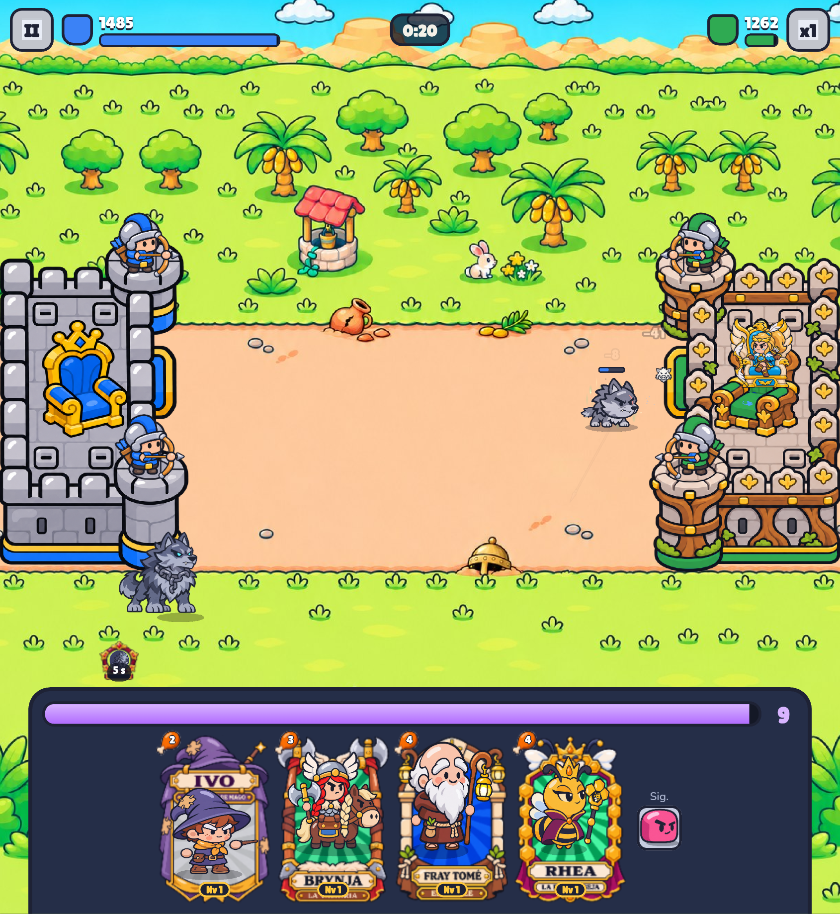

# Bug 2026-11-12T21:13:04.572Z

Garra está extremadamente, hay que bajarle el daño.



```json
{
 "pantalla": "batalla",
 "fecha": "2026-11-12T21:13:04.572Z",
 "ancho": 845,
 "alto": 919,
 "dpr": 2.549999952316284,
 "ua": "Mozilla/5.0 (Linux; Android 10; K) AppleWebKit/537.36 (KHTML, like Gecko) Chrome/156.0.0.0 Safari/537.36",
 "batalla": true,
 "tiempo": 21,
 "run": {
  "kind": "nivel",
  "k": "bosque",
  "i": 0
 },
 "mano": [
  "ivo",
  "valkiria",
  "fraile",
  "rhea"
 ],
 "unidades": [
  "lobo:b:idle:32"
 ]
}
```
