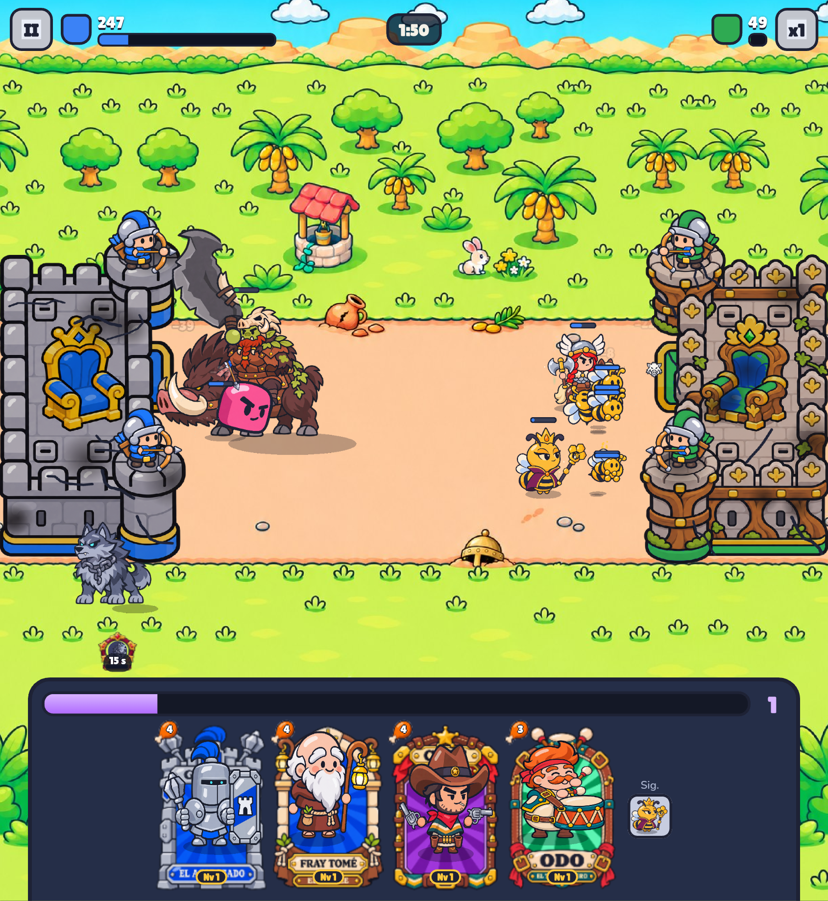

# Bug 2026-11-12T21:21:51.303Z

El héroe saltó e ignoró a mis unidades. Eso no puede ocurrir con los héroes, si le estoy atacando al castillo tiene que defenderlo



```json
{
 "pantalla": "batalla",
 "fecha": "2026-11-12T21:21:51.303Z",
 "ancho": 845,
 "alto": 919,
 "dpr": 2.549999952316284,
 "ua": "Mozilla/5.0 (Linux; Android 10; K) AppleWebKit/537.36 (KHTML, like Gecko) Chrome/156.0.0.0 Safari/537.36",
 "batalla": true,
 "tiempo": 111,
 "run": {
  "kind": "nivel",
  "k": "bosque",
  "i": 4
 },
 "mano": [
  "acorazado",
  "fraile",
  "pistolero",
  "odo"
 ],
 "unidades": [
  "rhea:b:attack:17",
  "valkiria:b:idle:64",
  "gull:p:attack:318",
  "abeja:b:die:0",
  "abeja:b:walk:22",
  "abeja:b:walk:22",
  "abeja:b:walk:22",
  "abeja:b:walk:22",
  "kubi:b:attack:115",
  "abeja:b:walk:22",
  "abeja:b:walk:22"
 ]
}
```
