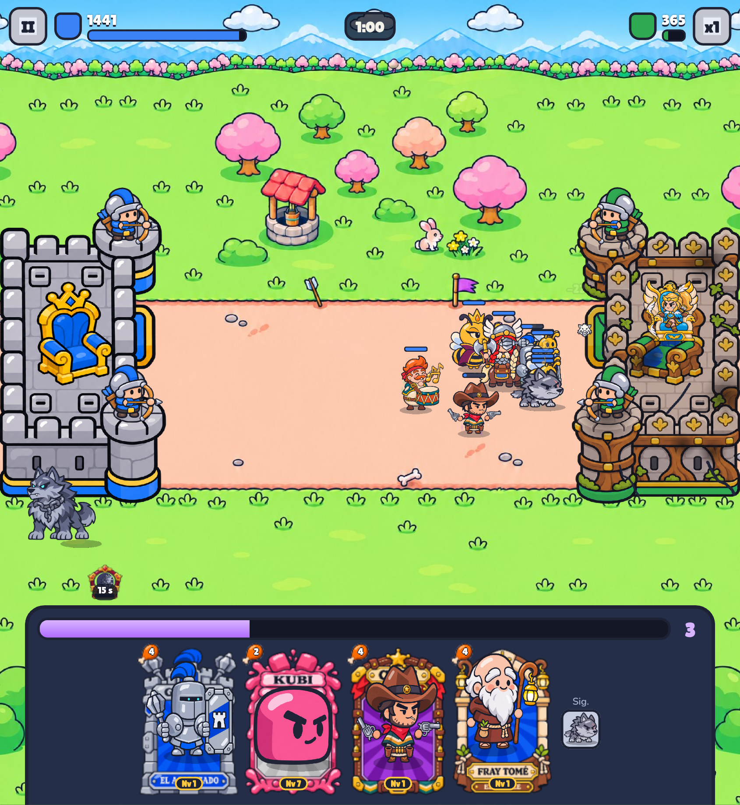

# Bug 2026-11-12T21:25:00.590Z

Me gustaría poder pinchar las unidades y que me saliera sus estadísticas actuales: Daño, vida, cooldown de alguna habilidad, si tiene algún buffo o nerf... También hay que modificar la barra de vida porque se distingue muy mal. Hay que hacer la barra de vida de los personajes más grandes y podríamos poner el porcentaje que le queda



```json
{
 "pantalla": "batalla",
 "fecha": "2026-11-12T21:25:00.590Z",
 "ancho": 845,
 "alto": 919,
 "dpr": 2.549999952316284,
 "ua": "Mozilla/5.0 (Linux; Android 10; K) AppleWebKit/537.36 (KHTML, like Gecko) Chrome/156.0.0.0 Safari/537.36",
 "batalla": true,
 "tiempo": 61,
 "run": {
  "kind": "nivel",
  "k": "bosque",
  "i": 6
 },
 "mano": [
  "acorazado",
  "kubi",
  "pistolero",
  "fraile"
 ],
 "unidades": [
  "acorazado:b:attack:134",
  "pistolero:b:attack:11",
  "valkiria:b:idle:142",
  "rhea:b:idle:130",
  "lobo:b:attack:18",
  "abeja:b:walk:22",
  "abeja:b:walk:22",
  "odo:b:idle:106",
  "abeja:b:walk:22",
  "abeja:b:walk:22",
  "abeja:b:walk:22",
  "abeja:b:walk:22"
 ]
}
```
