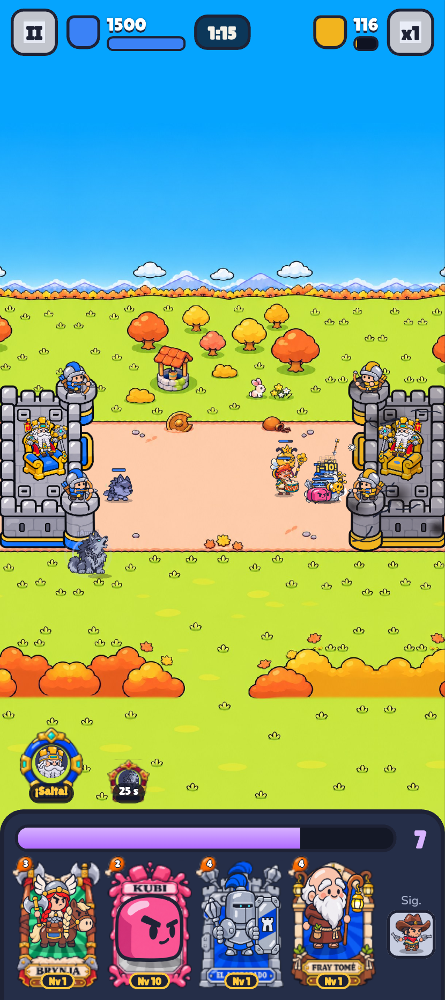

# Bug 2026-11-13T19:09:55.082Z

Al arrastrar unidades y dejarlas cerca del castillo se me cancela el despliegue. Tienes que agrandar la zona para que aún que toque el castillo pueda desplegarlo lo más cerca posible al castillo



```json
{
 "pantalla": "batalla",
 "fecha": "2026-11-13T19:09:55.082Z",
 "ancho": 415,
 "alto": 931,
 "dpr": 2.549999952316284,
 "ua": "Mozilla/5.0 (Linux; Android 10; K) AppleWebKit/537.36 (KHTML, like Gecko) Chrome/157.0.0.0 Mobile Safari/537.36",
 "batalla": true,
 "tiempo": 75,
 "run": {
  "kind": "nivel",
  "k": "desierto",
  "i": 4
 },
 "mano": [
  "valkiria",
  "kubi",
  "acorazado",
  "fraile"
 ],
 "unidades": [
  "acorazado:b:attack:260",
  "odo:b:idle:123",
  "kubi:b:attack:72",
  "rhea:b:attack:121",
  "kubi:b:idle:51",
  "abeja:b:die:0",
  "abeja:b:die:0",
  "lobo:b:attack:88",
  "abeja:b:attack:22",
  "abeja:b:attack:22",
  "abeja:b:attack:22",
  "abeja:b:attack:22",
  "ninja:p:attack:19",
  "abeja:b:attack:22",
  "lobo:b:spawn:50"
 ]
}
```
